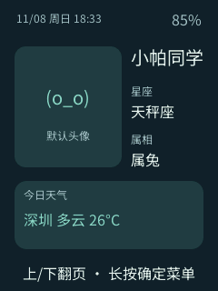
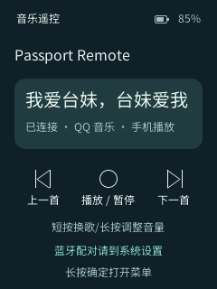
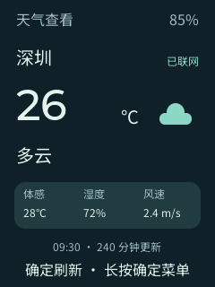
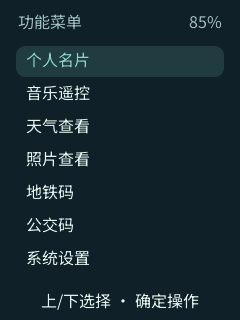
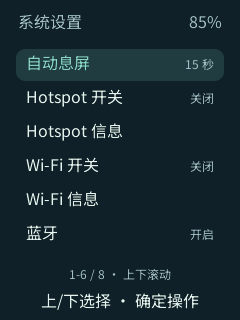
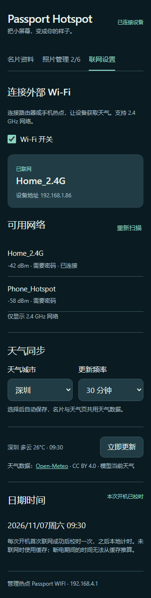

[简体中文](README.zh_CN.md) · **English**

# Passport Remote

Passport Remote is firmware for the FoloToy AI Passport (ESP32-C3, 8 MB flash). It combines a personal card, Bluetooth media remote, photo viewer and weather display on the device's three-button screen.

## What it does

- **Personal card** shows an avatar, name, constellation, zodiac, daily tag and weather summary. The device opens this page at startup.
- **Music remote** pairs with Android as `Passport Remote`. Use Up and Down to change tracks, OK to play or pause, and hold Up or Down to adjust volume. Tested with QQ Music.
- **Photo viewer** holds up to six photos. Use Up and Down to browse, and OK to enter or leave fullscreen. Images retain their aspect ratio.
- **Weather** supports Shenzhen and Wuhan, manual refresh and 30, 60, 120 or 240 minute updates. The card shares the weather data. The clock syncs once per boot after Internet access is available. Cached data is shown offline when available.
- **Settings** provides display timeout, independent controls for the setup hotspot and external Wi-Fi, and Bluetooth pairing management. Metro and bus code pages are interface placeholders.

Hold OK to open or return to the menu. Use Up and Down to select an entry and OK to open it.

### Device screens

| Personal card | Music remote | Weather |
| --- | --- | --- |
|  |  |  |
| View the profile and switch between the daily tag and weather. | Change tracks, play or pause, and adjust volume. | View current conditions and press OK to refresh. |

| Function menu | Photo viewer | System settings |
| --- | --- | --- |
|  |  |  |
| Hold OK to open the menu and select a feature. | Browse up to six photos and press OK for fullscreen. | Control the hotspot and external Wi-Fi separately and manage Bluetooth pairing. |

Screens are rendered from the firmware using sample data.

## Local management

Enable **Hotspot** in Settings, connect to `Passport WIFI` using the password shown under Hotspot Information, then open `http://192.168.4.1` in a browser. The local page edits the card, adds or replaces photos and configures external Wi-Fi and weather. External Wi-Fi credentials are entered in the browser.



The mobile preview uses sample network and weather data.

## Source map

The following files are under [main/](main/).

| File | Role |
| --- | --- |
| `main.c` | Starts the board services and application loop, dispatches button events and refreshes the display. |
| `passport_model.c / .h` | Defines pages, button actions, display timeout and the application state transitions. |
| `passport_ui.c / .h` | Builds the LVGL pages and displays profile, weather, connection and playback feedback. |
| `passport_text.h` | Centralizes device text and default profile values. |
| `passport_ble.c / .h` | Manages BLE pairing, reconnection and HID media commands. |
| `passport_wifi.c / .h` | Manages the setup hotspot, external Wi-Fi, network scanning and local HTTP routes. |
| `passport_web.html` | Provides the phone and computer interface for profile editing, photo management and network setup. |
| `passport_assets.c / .h` | Stores profiles and photos in flash and publishes validated uploads. |
| `passport_transfer.c / .h` | Validates upload format, dimensions, payload sizes and checksums. |
| `passport_store.c / .h` | Persists application settings in NVS. |
| `passport_weather.c / .h` | Synchronizes time, fetches weather over HTTPS and manages refresh and caching. |
| `passport_weather_model.c / .h` | Validates weather data and maps city names and weather codes for display. |
| `passport_font_inventory.h` | Lists glyphs required by the device interface. |
| `passport_photos.h` | Declares the bundled example photos. |
| `CMakeLists.txt` | Selects firmware sources, embeds the webpage and reads the local hotspot password at build time. |

[components/bsp/](components/bsp/) contains the display, buttons, battery, audio and I²C drivers. [assets/](assets/) holds fonts and example photos. [tests/](tests/) contains host checks. [tools/](tools/) contains validation, packaging and asset generation scripts. `demo_*` and `ui_pixel*` are reference code from the upstream project. [main/CMakeLists.txt](main/CMakeLists.txt) lists the sources included in this firmware.

## Build

Use ESP-IDF 5.5.3 with an activated environment. Set `PASSPORT_WIFI_PASSWORD` locally to an 8–63 character deployment password using letters, digits or `@._!+-`. In Bash:

```bash
read -rs -p 'Hotspot password: ' PASSPORT_WIFI_PASSWORD
export PASSPORT_WIFI_PASSWORD
./tools/validate.sh
unset PASSPORT_WIFI_PASSWORD
```

The verified merged image is written to `build/FoloToy-AI-Passport-full.bin` for address `0x0`. See the [firmware layout and flash data policy](docs/development/engineering/firmware-layout.md) before updating a device with saved data.

More details are in the [application guide and validation records](docs/development/passport-card-remote.md). Hardware and base firmware originate from [FoloToy AI Passport](https://gitee.com/FoloToy/ai-passport). See [LICENSE](LICENSE).
